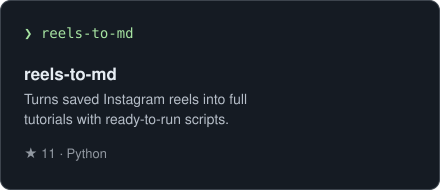
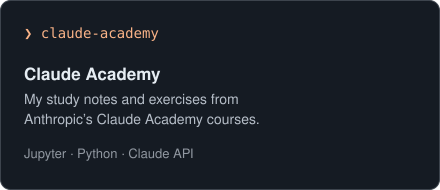
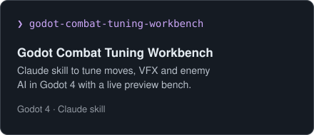
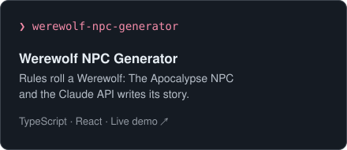
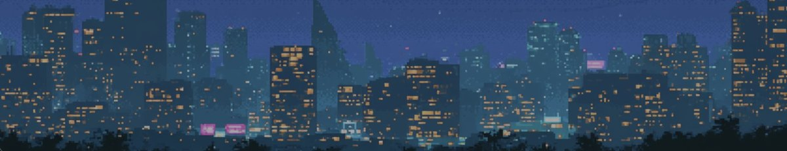

  

Like this terminal? <a href="https://github.com/joaocalixto/temas-claude-code">Grab my theme →</a>

  
  

## About me

> [!NOTE]
> This summary was written by Claude, based on my conversations with it, my projects and my resume, in October 2026.

I've been writing Java for more than 15 years, and I've also taught Java and Spring Boot. These days I spend a good part of my free time learning new things through my own projects: a game in Godot, an AI character generator, lofi music for my channel, and tools that automate my day-to-day.

### How I work

- **I look at what already exists first.** Before building, I gather references: moodboards for the game art, classic metroidvanias for the maps, what the community is already doing. Only then do I pick a path.
- **I learn by doing.** Every project is an excuse to learn something new: Godot and level design in the game, the Claude API in the NPC generator, animation and motion in a landing page.
- **I break problems into small pieces.** A map becomes rooms, an animation becomes poses, a character becomes rules. That way each piece can be tested and improved on its own.
- **I build a review loop.** Generate, review, write down what went wrong, improve. My game has reviewers for sprites and animations that keep their lessons in a notebook so they don't repeat the same mistake.
- **If I do it twice, it becomes a tool.** reels-to-md was born like that: it turns a saved reel into a tutorial with ready-to-run scripts.
- **I share the process.** I write about what I learned, including what didn't work, on LinkedIn, Instagram and Medium.

| | |
|---|---|
| **MSc** | Software Engineering (CESAR, Recife, 2016) |
| **Postgraduate** | Information Security in Software Engineering (CESAR, Recife, 2014) |
| **Certifications** | AWS Certified Cloud Practitioner Oracle Certified Professional, Java SE 6 Programmer (2014) |
| **Publication** | "An Analysis of Server Concepts and Design Flaws in Identity Management", ICSEA 2015 |

## Hackathons

| Year | Event | Result |
|:---:|---|:---:|
| 2026 | Internal AI Hackathon, Innovation & Engineering Hub, VW Group Services | 1st place |
| 2025 | Eclipse SDV Hackathon, Porto: COOTA, safe over-the-air software updates for cars | Participant |
| 2017 | NASA Space Apps Challenge | 1st place |
| 2017 | Hacking Health, Rio de Janeiro | 1st place |
| 2016 | IBM Green & SoftLayer Challenge, Recife | 2nd place |
| 2016 | Hackathon Viagens, São Paulo | 2nd place |
| — | Hacking Rio, Rio de Janeiro (sports category) | 2nd place |

## What I'm working on

<table>
  <tr>
    <td width="50%"></td>
    <td width="50%"></td>
  </tr>
  <tr>
    <td width="50%"></td>
    <td width="50%"></td>
  </tr>
</table>

## Tools I use

  

  
  

<!-- Just for fun: Pac-Man contribution graph. Turn back on once GitHub Actions is unlocked on the account.
## Just for fun

<picture>
  <source media="(prefers-color-scheme: dark)" srcset="https://raw.githubusercontent.com/joaocalixto/joaocalixto/output/pacman-contribution-graph-dark.svg">
  <source media="(prefers-color-scheme: light)" srcset="https://raw.githubusercontent.com/joaocalixto/joaocalixto/output/pacman-contribution-graph.svg">
  
</picture>
-->

